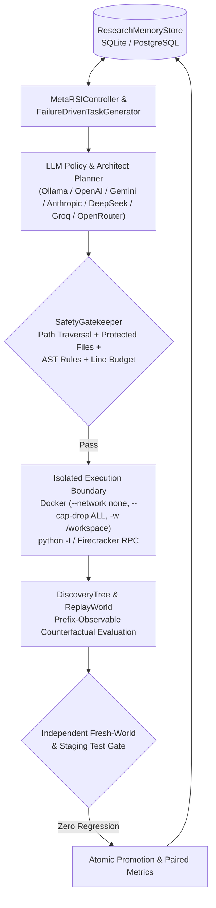

<div align="center">

# Dream-RSI

**Replay-Based Recursive Self-Improvement, Prefix-Observable Search, and Sandboxed Autonomous Code Evolution**

[](https://github.com/sylenthai/dream-rsi/actions/workflows/ci.yml)
[](https://github.com/sylenthai/dream-rsi/releases)
[](https://www.python.org/)
[](./dream_rsi/tests)
[](./SECURITY.md)
[](./LICENSE)

[Overview](#overview) •
[Why Dream-RSI](#why-dream-rsi-over-single-loop-agents) •
[Architecture](#architecture) •
[30-Second Quickstart](#30-second-quickstart) •
[Research Workflows](#core-research--engineering-workflows) •
[LLM Providers](#supported-llm-providers) •
[Security](#security--isolation-boundaries) •
[Production](#production-deployment) •
[Citation](#citation)

</div>

---

## Overview

**Dream-RSI** (`3.3.1`) is a bounded research and engineering platform for **replay-based recursive exploration-policy improvement**, **curriculum-driven coding synthesis**, **AST-guarded autonomous codebase self-evolution**, and **reproducible multi-model experimentation**.

Instead of letting an agent mutate policies blindly in one linear prompt loop, Dream-RSI separates **prefix-observable tree search** (`DiscoveryTree` / `TreeView`), **offline counter-factual replay worlds** (`ReplayWorld`), **independent fresh-world validation**, and **sandboxed staging promotion** (`AutonomousEvolutionEngine`) with persistent SQLite/PostgreSQL memory and Redis-backed distributed workers.

---

## Why Dream-RSI Over Single-Loop Agents?

| Capability | Typical Single-Loop Coding Agent | Dream-RSI `3.3.1` |
| --- | --- | --- |
| **Search & Exploration** | Greedy single trajectory or ad-hoc retries | `DiscoveryTree` + `TreeView` prefix-observable batch selection |
| **Policy Evaluation** | Re-runs expensive live tasks per tweak | Deterministic `ReplayWorld` offline policy evaluation + independent held-out fresh-world validation |
| **Meta-Learning** | Static system prompt | `MetaRSIController` synthesizes Python `PrefixPolicy` classes & failure-driven curriculum tasks across generations |
| **Self-Evolution Safety** | Unrestricted file edits or regex checks | `SafetyGatekeeper` (AST inspection, protected infrastructure files, path-traversal blocking) + isolated temp staging test suite gate |
| **Statistical Rigor** | Single cherry-picked score | `MultiModelResearchRunner` with multi-seed matrices & paired score deltas |
| **Execution Containment** | Host `exec()` or unsandboxed shell | Deny-by-default `ExecutionPolicy` (`--network none`, `--read-only`, `--cap-drop ALL`, `-w /workspace`), isolated `python -I`, & `FirecrackerBackend` RPC |
| **Production Operations** | Local CLI script only | FastAPI (`hmac.compare_digest` auth), Redis Streams queue w/ DLQ, PostgreSQL/SQLite `RunStore`, Prometheus `/metrics`, Docker, Kubernetes & Helm |

---

## Architecture



---

## 30-Second Quickstart

### Install & Verify Locally

```bash
git clone https://github.com/sylenthai/dream-rsi.git
cd dream-rsi

python -m venv .venv
# Linux / macOS:
source .venv/bin/activate
# Windows PowerShell:
# .venv\Scripts\Activate.ps1

python -m pip install -e ".[dev,api]"
python -m pytest -q
```

### Run the Offline Discovery-Tree Replay Demo

```bash
python -m dream_rsi.cli.run_demo
```

Sample output:

```text
iteration=1 world=world-1 selected=conservative
  conservative   replay_sum=1.275513
  width          replay_sum=1.275513
  best_world_reward=1.275513

iteration=2 world=world-2 selected=conservative
  conservative   replay_sum=1.275513
  width          replay_sum=1.275513
  best_world_reward=1.275513

iteration=3 world=world-3 selected=conservative
  conservative   replay_sum=1.275513
  width          replay_sum=1.275513
  best_world_reward=1.275513
```

---

## Core Research & Engineering Workflows

All CLI entrypoints are registered in [`pyproject.toml`](./pyproject.toml) when installed with `pip install -e .`:

| CLI / Module | Purpose | Example Invocation |
| --- | --- | --- |
| `dream-rsi-meta` (`dream_rsi.cli.meta_rsi`) | **Meta-RSI Loop**: Synthesizes new Python `PrefixPolicy` strategies & failure-driven tasks across generations | `dream-rsi-meta --mock --generations 2 --memory artifacts/meta.sqlite3` |
| `dream-rsi-evolve` (`dream_rsi.cli.evolve`) | **Autonomous Self-Evolution**: Introspects codebase, proposes bounded patch, checks `SafetyGatekeeper`, verifies in isolated temp repo staging | `dream-rsi-evolve --mock --cycles 1 --memory artifacts/evolve.sqlite3` |
| `dream-rsi-llm-coding` (`dream_rsi.cli.llm_coding`) | **Sandboxed Coding Synthesis**: Iterative generate-test-refine loop against deterministic I/O cases | `dream-rsi-llm-coding --provider ollama --model qwen3.5:9b --name addition --prompt "Read two ints and print sum" --case "2 3" "5"` |
| `dream-rsi-research-matrix` (`dream_rsi.cli.research_matrix`) | **Multi-Model Evaluation Matrix**: Reproducible multi-seed, multi-task trials with descriptive aggregates & paired score deltas | `dream-rsi-research-matrix --provider ollama --models qwen3.5:9b --tasks sum-two,max-list --seeds 0,1 --workers 2` |
| `dream-rsi-repair` (`dream_rsi.cli.repair`) | **Repository Repair**: Generates unified patches, applies to ephemeral repo copy, and verifies inside Docker `-w /workspace` | `dream-rsi-repair --provider ollama --repository /path/to/repo --task "Fix edge-case failure"` |
| `dream-rsi-autonomous` (`dream_rsi.cli.autonomous`) | **Bounded Autonomous Loop**: Checkpointed cycle execution with persistent SQLite research memory | `dream-rsi-autonomous --provider ollama --model qwen3.5:9b --task sum-two --cycles 3` |
| `dream-rsi` (`dream_rsi.cli.research`) | **Core Policy Search CLI**: Full tree-discovery and replay-world policy optimization | `dream-rsi --policy-provider toy` |
| `dream-rsi-worker` (`dream_rsi.cli.worker`) | **Distributed Worker**: Consumes experiment jobs from Redis Streams or in-memory queue | `dream-rsi-worker` |

---

## Supported LLM Providers

`dream_rsi.llm.factory.create_llm(provider, model)` includes hardened JSON extraction (`extract_json` strips `<think>...</think>` blocks, prose preambles, and fenced markdown blocks) and built-in retry handling across local and cloud APIs:

| Provider Key | Client Class | Environment Variable | Default Model | Default Endpoint |
| --- | --- | --- | --- | --- |
| `ollama` | `OllamaClient` | `OLLAMA_BASE_URL` | `qwen3.5:9b` | `http://127.0.0.1:11434` |
| `openai` / `openai-compatible` | `OpenAICompatibleClient` | `OPENAI_API_KEY` | `gpt-5.6-mini` | `https://api.openai.com/v1` |
| `gemini` | `GeminiClient` | `GEMINI_API_KEY` / `GOOGLE_API_KEY` | `gemini-2.5-flash` | Google Generative Language `v1beta` (`x-goog-api-key` header) |
| `anthropic` / `claude` | `AnthropicClient` | `ANTHROPIC_API_KEY` | `claude-3-5-sonnet-latest` | `https://api.anthropic.com` |
| `deepseek` | `OpenAICompatibleClient` | `DEEPSEEK_API_KEY` | `deepseek-chat` | `https://api.deepseek.com/v1` |
| `groq` | `OpenAICompatibleClient` | `GROQ_API_KEY` | `llama-3.3-70b-versatile` | `https://api.groq.com/openai/v1` |
| `openrouter` | `OpenAICompatibleClient` | `OPENROUTER_API_KEY` | `openai/gpt-4o-mini` | `https://openrouter.ai/api/v1` |

Python usage example:

```python
from dream_rsi.llm import create_llm, extract_json

llm = create_llm("deepseek")  # or "anthropic", "gemini", "groq", "openrouter", "ollama", "openai"
response = llm.generate([{"role": "user", "content": "Return JSON: {\"status\": \"ready\"}"}])
data = extract_json(response.text)
```

*(Note: Individual CLI `--provider` arguments currently enforce `ollama`, `openai`, `openai-compatible`, and `gemini`; use the Python API or `OPENAI_BASE_URL` for compatible endpoints via CLI.)*

---

## Security & Isolation Boundaries

Dream-RSI follows a strict **deny-by-default containment model**. See [`SECURITY.md`](./SECURITY.md) for complete threat-model details.

1. **Docker & Repository Sandbox (`ExecutionPolicy` / `DockerSandbox` / `RepositoryRunner`)**:
   - `--network none`, `--read-only` root filesystem, `--cap-drop ALL`, `--security-opt no-new-privileges`.
   - Strict `--pids-limit`, `--memory`, `--cpus`, timeout, and bounded `noexec,nosuid` `/tmp` tmpfs.
   - Explicit working-directory confinement (`-w /workspace`) and permission preparation for unprivileged container UIDs.
   - When `DREAM_RSI_ENV=production`, local host subprocess fallback is **disabled by default**.
2. **Hardened Local Subprocess Sandbox (`PythonSandbox` & `PythonExecutor`)**:
   - Executes with `sys.executable -I` (Python isolated mode).
   - Sanitizes `env` down to `PATH`, `PYTHONNOUSERSITE=1`, and `PYTHONDONTWRITEBYTECODE=1`, preventing leakage of host API keys (`OPENAI_API_KEY`, `GEMINI_API_KEY`, `DREAM_RSI_API_KEY`, etc.) to generated code.
3. **AST & Path Guardrails for Autonomous Evolution (`SafetyGatekeeper` & `AutonomousEvolutionEngine`)**:
   - Rejects `..` path traversal, absolute paths, drive letters, and writes escaping `repo_root`.
   - Protects core infrastructure, sandbox, security, policy registry, and evolution guardrail modules from autonomous overwrites.
   - AST inspection blocks forbidden imports (including submodules such as `ctypes.util`), dynamic built-ins (`eval`, `exec`, `compile`, `__import__`), syntax errors, and oversized patches (`max_lines_per_patch`).
4. **High-Assurance MicroVM Boundary (`FirecrackerBackend`)**:
   - Explicit HTTP RPC integration boundary for delegating hostile multi-tenant workloads to external Firecracker/gVisor workers rather than faking isolation in-process.
5. **FastAPI Control Plane (`dream_rsi.api.app`)**:
   - Constant-time `hmac.compare_digest` bearer / `X-API-Key` validation, fail-closed production mode (`503` if unconfigured), and lazy storage initialization without import-time disk writes.

---

## Production Deployment

### Docker Compose (API + Redis Streams Worker + PostgreSQL + Prometheus)

```bash
cp .env.example .env
# Replace all placeholder secrets in .env with strong unique credentials
docker compose -f docker-compose.production.yml up --build -d
```

The production [`Dockerfile`](./Dockerfile) installs `.[api,database,queue,observability]`, runs as non-root `appuser` (`uid 10001`), and exposes:

- `GET /healthz` — Liveness probe
- `GET /readyz` — Readiness probe (verifies DB and queue connectivity)
- `GET /metrics` — Prometheus exposition format (protected in production by default)
- `POST /v1/experiments` — Idempotent experiment submission (`Idempotency-Key`)
- `GET /v1/experiments/{run_id}` & `POST /v1/experiments/{run_id}/cancel`

Kubernetes and Helm manifests (configured with `readOnlyRootFilesystem: true`, dropped capabilities, and synchronized `DREAM_RSI_POSTGRES_DSN` / `DREAM_RSI_REDIS_URL` bindings for both API and worker pods) live under [`deploy/`](./deploy).

---

## Testing & Verification

```bash
# Run full test suite (59 tests)
python -m pytest -q

# Compile all modules to bytecode
python -m compileall -q dream_rsi

# Run offline demo smoke check
python -m dream_rsi.cli.run_demo

# Full release hygiene & version consistency check
make check-release
```

---

## Research Interpretation

Bundled toy environments and algorithmic coding tasks validate the discovery-tree, replay, meta-evolution, and safety-gating protocols end-to-end. They are **not** claims of general intelligence or superiority on external software-engineering leaderboards; substantive empirical studies should plug in domain-specific task adapters and independently held-out evaluation suites via [`dream_rsi/evaluators/`](./dream_rsi/evaluators).

---

## Citation

If Dream-RSI supports your research, you can cite it using [`CITATION.cff`](./CITATION.cff):

```bibtex
@software{sylenthai_dream_rsi_3_3_1,
  author       = {sylenthai},
  title        = {{Dream-RSI}: Replay-Based Recursive Exploration-Policy Improvement \& Self-Evolution Framework},
  version      = {3.3.1},
  url          = {https://github.com/sylenthai/dream-rsi},
  license      = {Apache-2.0}
}
```

## Contributing & License

Contributions are welcome — please read [`CONTRIBUTING.md`](./CONTRIBUTING.md) and [`CODE_OF_CONDUCT.md`](./CODE_OF_CONDUCT.md). Licensed under the **Apache License 2.0** ([`LICENSE`](./LICENSE)).
